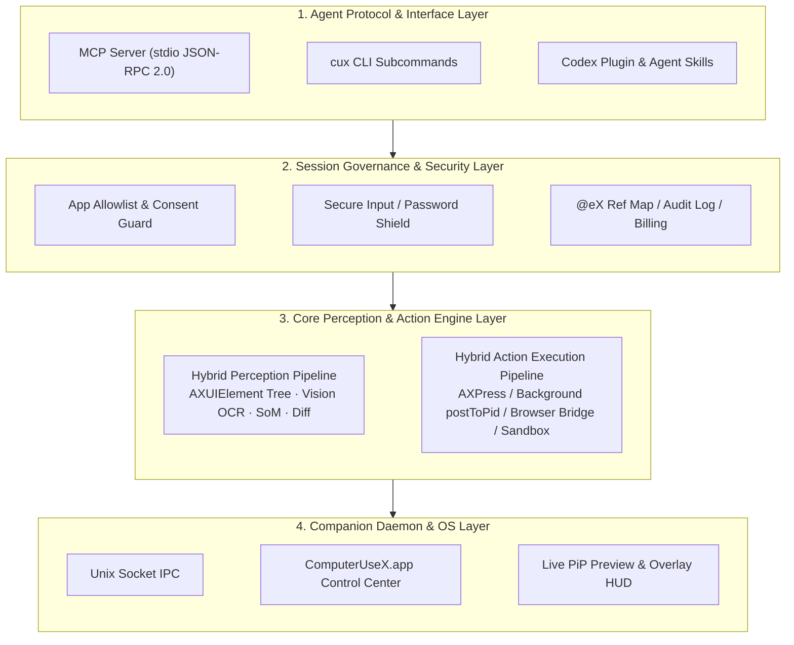

# ComputerUseX (`cux`)

**Native macOS Desktop Perception & GUI Automation Engine for AI Agents (MCP Server, CLI & Client Plugins)**

[English](./README.md) | [简体中文](./README_CN.md) | [Security Policy](./SECURITY.md) | [Contributing](./CONTRIBUTING.md) | [Changelog](./CHANGELOG.md)

`ComputerUseX` (`cux`) is a native Swift 6 (zero external dependencies) desktop perception and GUI automation toolkit built for **OpenAI Codex, Claude Code / Desktop, OpenClaw, OpenCode, Pi, MiniMaxCode, Harness, Cursor, Windsurf, and Antigravity**.

It bridges AI Agents to desktop applications by combining macOS Accessibility trees (`AXUIElement`), on-device Apple `Vision` OCR, Set-of-Marks (`SoM`) visual grounding, and background event synthesis (`AXPress` / `CGEvent.postToPid`), allowing Agents to inspect and operate desktop apps without hijacking your physical mouse or foreground window focus.

---

## 🚀 Quick Start & Installation

### 1. Install
```bash
# Option A: One-line installer (downloads prebuilt release binary or builds from source)
curl -fsSL https://raw.githubusercontent.com/luorenyu/ComputerUseX/main/scripts/install.sh | bash

# Option B: Clone & install from source
git clone https://github.com/luorenyu/ComputerUseX.git
cd ComputerUseX
./scripts/install.sh
```

The installer (or `cux install-mcp [all|codex|claude|openclaw|opencode|pi|minimax|harness|cursor|windsurf|gemini]`) automatically detects and configures your installed AI Agents:

| Supported AI Agent | Auto-Registered MCP Config | Auto-Installed Plugin / Skill Path |
| :--- | :--- | :--- |
| **OpenAI Codex** | `~/.codex/config.toml` | `~/.codex/plugins/cache/computer-use-x/...`<br/>`~/.codex/skills/computer-use-x/SKILL.md` |
| **Claude Code / Desktop** | `~/.claude.json`<br/>`~/Library/Application Support/Claude/claude_desktop_config.json` | `~/.claude/skills/computer-use-x/SKILL.md` |
| **OpenClaw** | `~/.openclaw/openclaw.json` (`mcp.servers`) | `~/.openclaw/skills/computer-use-x/SKILL.md` |
| **OpenCode** | `~/.config/opencode/opencode.json` (`mcp`) | `~/.config/opencode/skills/computer-use-x/SKILL.md` |
| **Pi (`pi-coding-agent`)** | `~/.pi/agent/mcp.json` | `~/.pi/agent/skills/computer-use-x/SKILL.md` |
| **MiniMaxCode (`mmx`)** | `~/.minimax-code/mcp.json` | `~/.minimax-code/skills/computer-use-x/SKILL.md` |
| **Harness / Hermes** | `~/.harness/mcp.json`<br/>`~/.hermes/config.yaml` | `~/.harness/skills/computer-use-x/SKILL.md` |
| **Cursor / Windsurf** | `~/.cursor/mcp.json`<br/>`~/.codeium/windsurf/mcp_config.json` | Global `~/.agents/skills/computer-use-x/SKILL.md` |
| **Antigravity / Gemini** | `~/.gemini/settings.json`<br/>`~/.gemini/antigravity/mcp_config.json` | Global `~/.agents/skills/computer-use-x/SKILL.md` |

### 2. Grant Permissions & Launch Companion App
```bash
open /Applications/ComputerUseX.app
cux dashboard
```
Enable **Accessibility** and **Screen Recording** permissions in the Control Center when prompted.

---

## 🛠️ Core Features & Usage

### 1. Hybrid UI Perception (`snapshot`, `query`, `wait`)
`cux` extracts interactive elements from any running application and assigns deterministic references (`@e1`, `@e2`, ...). If an app uses custom rendering (Electron, WeChat, canvas views) where `AXUIElement` nodes are missing, `cux` automatically falls back to Apple `Vision` OCR (`zh-Hans` + `en-US`) and merges results via IoU deduplication.

```bash
# Capture compact snapshot of a target app (top salient interactive elements)
cux snapshot --app "WeChat" --compact

# Capture only incremental changes since the last snapshot
cux snapshot --app "WeChat" --diff

# Generate a Set-of-Marks (SoM) annotated screenshot with @eX bounding boxes
cux snapshot --app "Safari" --som /tmp/safari_som.png

# Fast element lookup by role or text without dumping the full tree
cux query --app "Notes" --role button --text "New"

# Wait until specific text appears in the target app (polls AX + OCR)
cux wait "Send" --app "WeChat" --timeout 10
```

### 2. Background GUI Actions (`click`, `type`, `press`, `scroll`, `drag`, `batch`)
Actions are routed through native Accessibility actions (`AXPress`, `AXValue`) or window-targeted `CGEvent` synthesis first, keeping your hardware cursor and active foreground window undisturbed. When operating a background window, `ComputerUseX.app` displays a Live Picture-in-Picture (PiP) preview in the bottom-right corner.

```bash
# Click by element reference, fuzzy text label, or screen coordinates
cux click @e3
cux click "Search" --app "WeChat"
cux click --x 420 --y 310 --right

# Type multi-language text into an input field, optionally clearing first and submitting
cux type @e5 "Hello from ComputerUseX" --clear --submit

# Send keyboard shortcuts or key presses
cux press cmd+k --app "Slack"
cux press enter

# Scroll or drag between elements
cux scroll --dy -300 --ref @e8
cux drag --from @e2 --to @e9

# Execute a multi-step sequence in a single call
cux batch 'click @e3 ; wait 0.5 ; type @e5 "Automated message" --submit'
```

### 3. Browser Inspection & JS Bridge (`browser`)
Inspect open browser tabs, extract a simplified interactive DOM, or evaluate JavaScript in **Chrome, Safari, Arc, Brave, and Edge** without bringing the browser window to the front.

```bash
# List all open tabs and active URLs
cux browser --app "Google Chrome" --tabs

# Extract interactive DOM elements (links, buttons, inputs)
cux browser --app "Google Chrome" --dom

# Run custom JavaScript in the active tab
cux browser --app "Google Chrome" --js "document.title"
```

### 4. Access Control, Window Sandbox & Usage Tracking (`dashboard`, `sandbox`, `bill`)
- **App Authorization (`cux dashboard`)**: Configure whether Agents can operate any application or must request approval per app via an allowlist.
- **Window Sandbox (`cux sandbox`)**: Move background target windows to a peripheral screen region (`--park`) during automation and restore their original frame (`--restore`) afterward.
- **Session Telemetry (`cux bill`)**: Record task duration, tool execution time, and estimated token usage across multi-step Agent workflows.

```bash
# Open the desktop Control Center (Usage History & Access Control)
cux dashboard

# Park and restore a background app window
cux sandbox --park --app "WeChat"
cux sandbox --restore

# Finish a task session and close the Live PiP preview
cux bill --finish --agent "Codex" --model "gpt-5"
```

### 5. MCP Server Tools Reference (17 Tools)
When running as an MCP server (`cux mcp`), the following tools are exposed over `stdio` JSON-RPC 2.0:

| Tool | Description |
| :--- | :--- |
| `cux_status` | Check TCC permissions, daemon connection, screen geometry, and cursor coordinates |
| `cux_apps` | List running GUI apps & windows, or launch/activate/resize a target application |
| `cux_snapshot` | Capture hybrid UI snapshot (`@e1..@eN`) with `compact`, `diff`, and optional SoM image |
| `cux_query` | Query matching UI elements by `role` or `text` without a full tree dump |
| `cux_click` | Click by `@eX` reference, fuzzy label, or `(x, y)` coordinates (`left`/`right`/`double`/`ax_native`) |
| `cux_move` | Move virtual pointer to `@eX` or `(x, y)` |
| `cux_type` | Input text via `AXValue` or transactional pasteboard with `clear` and `submit` options |
| `cux_press` | Send key press or shortcut combination (`cmd+c`, `cmd+shift+p`, `enter`, `escape`, `tab`) |
| `cux_scroll` | Pixel scrolling (`dx`, `dy`) at current pointer or target `@eX` |
| `cux_drag` | Drag between two element references (`@e1` -> `@e2`) or coordinate pairs |
| `cux_wait` | Poll until target text appears on screen (AX + OCR) or sleep for fixed seconds |
| `cux_batch` | Execute multiple DSL commands (`click`, `type`, `press`, `wait`) in one call |
| `cux_upload_file` | Select and confirm a local file path inside a macOS Open/Save file dialog |
| `cux_secondary_action` | Trigger native Accessibility actions (`AXShowMenu`, `AXIncrement`, `AXDecrement`, etc.) |
| `cux_browser` | Inspect tabs, simplified DOM, or run JavaScript in Chrome, Safari, Arc, Brave, and Edge |
| `cux_sandbox` | Park or restore background windows during automation |
| `cux_bill` | Query or finalize task session telemetry and close active PiP preview sessions |

---

## 🏗️ Architecture Design

`ComputerUseX` consists of the `cux` CLI/MCP binary, the `ComputerUseX.app` companion daemon, and the shared `OCUCore` library, organized into **four layers**:



### Layer Responsibilities & Module Mapping

| Layer | Core Modules | Source Path | Responsibilities |
| :--- | :--- | :--- | :--- |
| **1. Agent Protocol & Interface Layer** | `MCPServer`<br/>`cux` CLI<br/>`Plugins & Skills` | `Sources/OCUCore/MCP/`<br/>`Sources/cux/`<br/>`plugins/codex/` | Parses MCP (`stdio` JSON-RPC 2.0) and CLI requests; provides the native OpenAI Codex plugin and reusable Agent Skill definitions. |
| **2. Session Governance & Security Layer** | `AuditAndSecurityGuard`<br/>`SessionBillingManager`<br/>`Models` | `Sources/OCUCore/Safety/`<br/>`Sources/OCUCore/Models/` | Enforces app allowlists and triggers interactive approval prompts; detects `SecureEventInput` and password fields to block sensitive keystrokes; performs real-time `KERN_PROCARGS2` operator/model detection; persists `@e1..@eN` mappings and `~/.computerusex/` audit/billing logs. |
| **3. Core Perception & Action Engine Layer** | **Perception**: `AXScanner` / `VisionOCRScanner` / `ScreenCaptureService` / `ElementSnapshotStore`<br/>**Execution**: `MouseController` / `KeyboardController` / `AppWorkspaceController` / `BrowserBridgeController` / `SyntheticFocusEnforcer` | `Sources/OCUCore/Perception/`<br/>`Sources/OCUCore/Action/`<br/>`Sources/OCUCore/Permissions/` | **Perception**: Traverses `AXUIElement` trees (with off-Space remote token discovery & automatic Chromium UI Zoom calibration) + Apple `Vision` OCR (`IoU > 0.45` deduplication) + `dHash` fingerprints + SoM annotation + post-action incremental diffs.<br/>**Execution**: **3-tier routing** (Tier 1 native `AXPress`/`AXValue` → Tier 2 background `CGEvent.postToPid` → Tier 3 hardware `CGEvent` fallback), multi-monitor/cross-Space zero-interruption window handling, rich-text editor activation, browser DOM/JS bridge, and window sandboxing. |
| **4. Companion Daemon & OS Layer** | `UnixSocketIPC`<br/>`ComputerUseXApp` | `Sources/OCUCore/IPC/`<br/>`Sources/ComputerUseXApp/` | Bridges stateless CLI calls to the resident `ComputerUseX.app` via `/tmp/cux-<uid>.sock`, hosting the Control Center, smart background Live PiP preview (auto-hidden when target window is already frontmost), and screen overlay HUD. |

---

## 🧭 Extensibility & Future Architecture Roadmap

`ComputerUseX` is designed with modular boundaries inside `Sources/OCUCore/` so the core perception and execution pipeline can be extended in the following directions:

### 1. Cross-Platform OS Backends (Linux & Windows)
The upper layers (MCP Server, CLI router, Snapshot Diff Engine, Reference Mapping, and Audit/Billing) operate on platform-agnostic `UIElementNode` and `SnapshotResult` structs. Future work abstracts OS-specific drivers behind protocol interfaces:
- **macOS (Current)**: `AXUIElement` + Apple `Vision` + `CoreGraphics`.
- **Linux (Planned)**: `AT-SPI2` accessibility bus + `X11` (`XTest` / `XComposite`) / `Wayland` (`wlr-screencopy` / `ydotool`) + ONNX/Tesseract OCR.
- **Windows (Planned)**: Windows `UIAutomation` (`IUIAutomation`) + `WinRT GraphicsCapture` + `SendInput` / `Windows.Media.Ocr`.

### 2. Pluggable Local VLM & Custom Grounding Providers
For applications rendered entirely inside a GPU canvas (e.g., games, remote desktop viewers, custom Flutter/Skia surfaces) where neither `AXUIElement` nor text OCR captures icon semantics:
- Introduce a `GroundingProvider` protocol in Layer 3 allowing external or local Apple Silicon MLX / CoreML UI detection models (such as OmniParser or UI-TARS) to plug directly into the `@e1..@eN` fusion pipeline alongside `AXEngine` and `VisionOCREngine`.

### 3. Direct Chrome DevTools Protocol (CDP) & WebDriver BiDi Engine
Currently `BrowserBridge` uses AppleScript/JXA for zero-config inspection of open browser windows. Extending `BrowserBridge` with an optional direct **CDP WebSocket client** will enable:
- Full Accessibility Tree (`Accessibility.getFullAXTree`) and shadow-DOM inspection inside Chromium browsers.
- Network request interception and console log streaming during Agent web workflows.

### 4. Workflow Recording & Deterministic Replay (`cux record` / `cux replay`)
By hooking into macOS event taps and Layer 3 snapshots, human actions can be recorded into semantic `cux batch` workflows (binding actions to resilient `@eX` role/title selectors rather than brittle `(x, y)` coordinates) and exported as reusable Agent Skills.

### 5. Remote & VM Sandbox Execution Target (`cux --remote`)
Because Layer 1–2 and Layer 3–5 communicate through structured command models and IPC payloads, `cux` can be extended to forward execution over SSH or gRPC to an isolated **macOS Virtualization.framework VM** (e.g., Tart), allowing Agents to run untrusted workflows inside a disposable virtual desktop while streaming the Live PiP preview back to the host.

---

## 📂 Project Structure

```text
ComputerUseX/
├── Package.swift                       # Swift 6 package manifest (OCUCore, cux, ComputerUseXApp)
├── Sources/
│   ├── OCUCore/                        # Core engine library
│   │   ├── Models/                     # UIElementRef, SnapshotResult, IPC & Audit models
│   │   ├── Perception/                 # AXScanner, VisionOCRScanner, ScreenCaptureService, ElementSnapshotStore, SoMAnnotator
│   │   ├── Action/                     # MouseController, KeyboardController, AppWorkspaceController, BrowserBridgeController, SyntheticFocusEnforcer
│   │   ├── Permissions/                # PermissionManager & multi-display geometry discovery
│   │   ├── Safety/                     # AuditAndSecurityGuard, KillSwitchMonitor & SessionBillingManager
│   │   ├── IPC/                        # UnixSocketIPC & OCUCommandExecutor (/tmp/cux-<uid>.sock)
│   │   └── MCP/                        # stdio JSON-RPC 2.0 MCP Server (17 tools)
│   ├── cux/                            # CLI & MCP executable entry point
│   └── ComputerUseXApp/                # Companion macOS MenuBar app, Dashboard, VirtualCursor & Live PiP HUD
├── plugins/codex/                      # Native OpenAI Codex plugin (.codex-plugin & marketplace)
├── skills/computer-use-x/              # Agent Skill definition (SKILL.md)
├── scripts/                            # Build (build-app.sh) & one-click installer (install.sh)
└── Tests/OCUCoreTests/                 # Unit test suite
```

---

## 🧪 Development & Testing

```bash
# Build release binaries and package ComputerUseX.app
./scripts/build-app.sh

# Run unit tests
swift test
```

---

## 📈 Star History

<a href="https://star-history.com/#luorenyu/ComputerUseX&Date">
 <picture>
   <source media="(prefers-color-scheme: dark)" srcset="https://api.star-history.com/svg?repos=luorenyu/ComputerUseX&type=Date&theme=dark" />
   <source media="(prefers-color-scheme: light)" srcset="https://api.star-history.com/svg?repos=luorenyu/ComputerUseX&type=Date" />
   
 </picture>
</a>

---

## 📄 License

Licensed under the [MIT License](./LICENSE).
