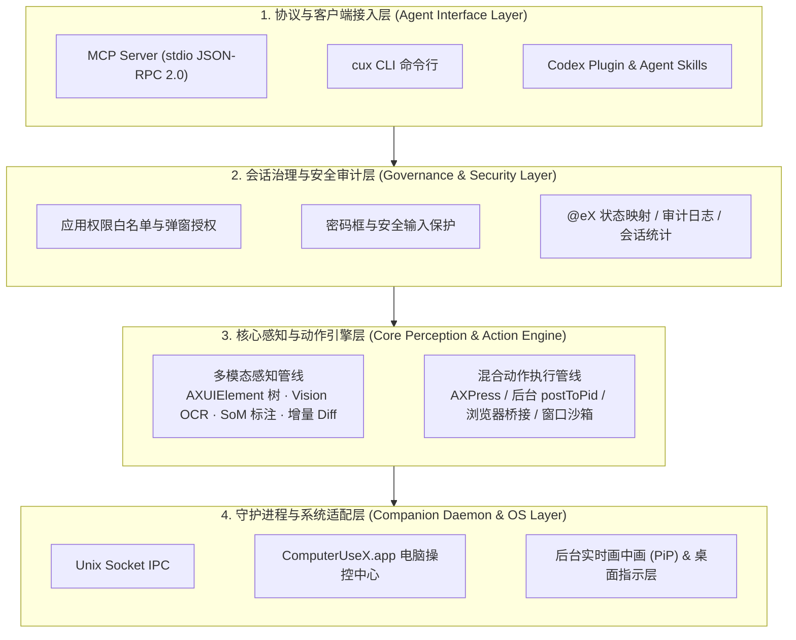

# ComputerUseX (`cux`)

**面向 AI Agent 的 macOS 原生桌面感知与 GUI 自动化引擎（MCP Server · CLI · 客户端插件）**

[English](./README.md) | [简体中文](./README_CN.md) | [安全架构](./SECURITY.md) | [贡献指南](./CONTRIBUTING.md) | [更新日志](./CHANGELOG.md)

`ComputerUseX` (`cux`) 是一款基于 **原生 Swift 6（零第三方依赖）** 构建的 macOS 桌面界面感知与 GUI 自动化工具，支持 **OpenAI Codex、Claude Code、Claude Desktop、Cursor、Antigravity、Windsurf** 等主流 AI Agent。

通过将 macOS 原生无障碍树（`AXUIElement`）、端侧 Apple `Vision` OCR 识别、Set-of-Marks（`SoM`）视觉标注与后台事件合成（`AXPress` / `CGEvent.postToPid`）结合，`ComputerUseX` 让 Agent 能够直接读取并操控后台应用，无需抢占用户的物理鼠标或打断前台工作窗口。

---

## 🚀 快速安装与启动

### 1. 安装
```bash
# 方式 A：一行命令自动安装（优先下载 GitHub Release 预编译包，或自动本地编译）
curl -fsSL https://raw.githubusercontent.com/luorenyu/ComputerUseX/main/scripts/install.sh | bash

# 方式 B：克隆源码并编译安装
git clone https://github.com/luorenyu/ComputerUseX.git
cd ComputerUseX
./scripts/install.sh
```

安装脚本会自动完成以下配置：
- 将桌面端应用安装至 `/Applications/ComputerUseX.app`（提供状态栏守护进程、电脑操控中心与后台实时画中画预览）。
- 将命令行工具 `cux` 软链至 `~/.local/bin/cux`（及 `/usr/local/bin/cux`）。
- 自动注册 **OpenAI Codex** 原生插件（`~/.codex/plugins/cache/...`）、全局 Skill（`~/.codex/skills/computer-use-x`）及 `~/.codex/config.toml` MCP 配置。
- 自动将 `computer-use-x` MCP 服务写入 **Claude Code / Desktop**、**Cursor** 与 **Antigravity / Gemini** 配置文件。

### 2. 授予系统权限并打开控制面板
```bash
open /Applications/ComputerUseX.app
cux dashboard
```
首次启动后，在「电脑操控中心」引导条中开启 macOS **辅助功能（Accessibility）** 与 **屏幕录制（Screen Recording）** 权限即可使用。

---

## 🛠️ 核心功能与使用指南

### 1. 混合界面感知（`snapshot` / `query` / `wait`）
`cux` 会提取目标应用窗口中的可交互控件，并分配确定性的引用标号（`@e1`, `@e2`, ...）。当遇到微信、Electron 或自绘 Canvas 等无障碍节点缺失的界面时，会自动调用 Apple `Vision` 框架（`zh-Hans` + `en-US`）进行端侧 OCR 兜底，并通过 IoU 重叠度去重与 AX 节点合并。

```bash
# 获取目标应用的精简快照（仅保留核心可交互元素，节省上下文 Token）
cux snapshot --app "WeChat" --compact

# 增量模式：仅返回相比上一次快照新增、移除或数值发生变化的节点
cux snapshot --app "WeChat" --diff

# 生成带 @eX 编号框标注的 Set-of-Marks (SoM) 截图，供多模态模型视觉校验
cux snapshot --app "Safari" --som /tmp/safari_som.png

# 按控件类型或文本快速检索元素（无需导出整棵 UI 树）
cux query --app "Notes" --role button --text "新建"

# 等待目标文本出现在界面上（自动轮询 AX 树 + OCR）
cux wait "发送" --app "WeChat" --timeout 10
```

### 2. 后台零焦点动作执行（`click` / `type` / `press` / `scroll` / `drag` / `batch`）
执行点击或输入时，`cux` 优先使用原生无障碍动作（`AXPress`、`AXValue`）或向目标进程 PID 定向投递后台合成事件（`CGEvent.postToPid`），不移动物理鼠标、不把后台窗口拉到前台。当后台应用正在被操控时，桌面右下角会保持开启实时画中画（PiP）预览小窗。

```bash
# 通过元素标号、文本模糊匹配或屏幕坐标执行点击
cux click @e3
cux click "搜索" --app "WeChat"
cux click --x 420 --y 310 --right

# 向输入框写入中英文文本（支持先清空 --clear 与输入后自动回车提交 --submit）
cux type @e5 "来自 ComputerUseX 的自动消息" --clear --submit

# 发送快捷键或功能键
cux press cmd+k --app "Slack"
cux press enter

# 滚动视图或在两个元素之间拖拽
cux scroll --dy -300 --ref @e8
cux drag --from @e2 --to @e9

# 单次调用批量执行多步 DSL 指令
cux batch 'click @e3 ; wait 0.5 ; type @e5 "Hello" --submit'
```

### 3. 浏览器免焦点桥接（`browser`）
无需把浏览器切到前台，即可直接读取 **Chrome、Safari、Arc、Brave、Edge** 的标签页列表、提取精简可交互 DOM，或在当前页面执行 JavaScript。

```bash
# 列出浏览器所有打开的标签页与 URL
cux browser --app "Google Chrome" --tabs

# 提取当前页面的可交互 DOM 元素（链接、按钮、输入框）
cux browser --app "Google Chrome" --dom

# 在活跃标签页中执行自定义 JavaScript
cux browser --app "Google Chrome" --js "document.title"
```

### 4. 权限管控、窗口沙箱与任务统计（`dashboard` / `sandbox` / `bill`）
- **应用授权控制（`cux dashboard`）**：在「电脑操控中心」管理“允许操作任意应用”或“首次访问新应用时弹窗授权”，维护应用白名单。
- **后台窗口沙箱（`cux sandbox`）**：在自动化期间将后台目标窗口停靠至屏幕边缘沙箱区（`--park`），操作完成后恢复原位（`--restore`）。
- **任务会话统计（`cux bill`）**：记录每次多步任务的整体耗时、工具执行耗时与预估 Token 消耗，并在任务结束（`--finish`）时关闭右下角实时预览窗。

```bash
# 打开「电脑操控中心」（查看调用历史或管理应用授权白名单）
cux dashboard

# 将目标应用移入边缘沙箱 / 恢复原窗口位置
cux sandbox --park --app "WeChat"
cux sandbox --restore

# 结束当前任务会话并收起右下角实时预览小窗
cux bill --finish --agent "Codex" --model "gpt-5"
```

### 5. MCP Server 工具列表（共 17 个工具）
以 MCP 模式运行（`cux mcp`）时，通过 `stdio` JSON-RPC 2.0 暴露以下 17 个标准工具：

| 工具名称 | 功能说明 |
| :--- | :--- |
| `cux_status` | 检查系统 TCC 权限状态、守护进程连接、屏幕分辨率与当前指针坐标 |
| `cux_apps` | 列出正在运行的 GUI 应用与窗口信息，或启动/激活/调整目标应用窗口大小 |
| `cux_snapshot` | 获取混合 UI 快照（`@e1..@eN`），支持 `compact`、`diff` 与 `som` 标注图 |
| `cux_query` | 按 `role` 或 `text` 快速查找匹配控件，无需输出完整 UI 树 |
| `cux_click` | 按 `@eX` 标号、模糊文本或 `(x, y)` 坐标点击（支持左键/右键/双击/`ax_native`） |
| `cux_move` | 将虚拟指针移动至指定 `@eX` 元素或 `(x, y)` 坐标 |
| `cux_type` | 通过 `AXValue` 或事务性剪贴板输入文本，支持 `clear` 清空与 `submit` 回车提交 |
| `cux_press` | 发送按键或组合快捷键（如 `cmd+c`, `cmd+shift+p`, `enter`, `escape`, `tab`） |
| `cux_scroll` | 在当前位置或指定 `@eX` 控件上执行像素级平滑滚动（`dx`, `dy`） |
| `cux_drag` | 在两个元素标号（`@e1` -> `@e2`）或两组坐标之间执行拖拽 |
| `cux_wait` | 轮询等待目标文本出现在界面上（AX + OCR）或固定等待指定秒数 |
| `cux_batch` | 单次调用连续执行多条 DSL 动作指令（`click`, `type`, `press`, `wait`） |
| `cux_upload_file` | 在 macOS 打开/保存文件对话框中自动选中并提交指定本地文件路径 |
| `cux_secondary_action` | 触发原生无障碍次级动作（如 `AXShowMenu`, `AXIncrement`, `AXDecrement`） |
| `cux_browser` | 免焦点读取 Chrome / Safari / Arc / Brave / Edge 标签页、精简 DOM 或执行 JS |
| `cux_sandbox` | 将后台窗口停靠至边缘沙箱或恢复原始窗口位置 |
| `cux_bill` | 查询或结算当前任务会话的耗时与 Token 统计，并关闭后台画中画预览 |

---

## 🏗️ 架构设计

`ComputerUseX` 由命令行/MCP 程序 `cux`、桌面常驻程序 `ComputerUseX.app` 以及共享核心库 `OCUCore` 组成，自上而下分为 **四层架构**：



### 各层职责与模块映射

| 架构分层 | 核心模块 | 源码目录 | 核心职责说明 |
| :--- | :--- | :--- | :--- |
| **第一层：协议与客户端接入层** | `MCPServer`<br/>`cux` CLI<br/>`Plugins & Skills` | `Sources/OCUCore/MCP/`<br/>`Sources/cux/`<br/>`plugins/codex/` | 解析 MCP (`stdio` JSON-RPC 2.0) 与 CLI 子命令请求；提供 OpenAI Codex 原生插件与通用 Skill 定义。 |
| **第二层：会话治理与安全审计层** | `AuditAndSecurityGuard`<br/>`Models` | `Sources/OCUCore/Safety/`<br/>`Sources/OCUCore/Models/` | 拦截未授权应用访问并触发弹窗授权；检测 `SecureEventInput` 与密码框防止敏感输入泄露；维护跨调用 `@e1..@eN` 映射表与 `~/.computerusex/` 审计统计。 |
| **第三层：核心感知与动作引擎层** | **感知**：`AXEngine` / `VisionOCR` / `Capture` / `Diff`<br/>**执行**：`ActionExecutor` / `BrowserBridge` / `Sandbox` | `Sources/OCUCore/AX/`<br/>`Sources/OCUCore/OCR/`<br/>`Sources/OCUCore/Capture/`<br/>`Sources/OCUCore/Perception/`<br/>`Sources/OCUCore/Action/`<br/>`Sources/OCUCore/Browser/`<br/>`Sources/OCUCore/Sandbox/` | **多模态感知**：遍历 `AXUIElement` 树 + Apple `Vision` 端侧 OCR（`IoU > 0.45` 去重融合）+ `dHash` 指纹 + SoM 标注 + `--diff` 增量对比。<br/>**三级动作执行**：Tier 1 原生 `AXPress`/`AXValue` → Tier 2 后台进程级 `CGEvent.postToPid` → Tier 3 硬件 `CGEvent` 兜底；含浏览器免焦点 DOM/JS 桥接与窗口边缘沙箱。 |
| **第四层：守护进程与系统适配层** | `UnixSocketIPC`<br/>`ComputerUseXApp` | `Sources/OCUCore/IPC/`<br/>`Sources/ComputerUseXApp/` | 通过 `/tmp/cux-<uid>.sock` 连接无状态 CLI 与常驻 `ComputerUseX.app`，承载「电脑操控中心」主面板、右下角后台窗口实时画中画（PiP）预览流及桌面操作指示层。 |

---

## 🧭 架构扩展能力与后续规划

`ComputerUseX` 在 `Sources/OCUCore/` 内部对数据结构（`UIElementNode`、`SnapshotResult`）与底层系统 API 进行了模块解耦，后续架构可沿以下方向扩展：

### 1. 跨平台系统驱动抽象（Linux & Windows 扩展支持）
目前第一层（MCP/CLI）、第二层（安全审计与账单）、第三层的快照 Diff 引擎与 IoU 融合逻辑均基于平台无关的 Swift 模型。后续可将第三层的系统原生调用抽象为统一的平台驱动协议（`PlatformPerceptionDriver` / `PlatformActionDriver`）：
- **macOS（当前）**：`AXUIElement` + Apple `Vision` + `CoreGraphics`。
- **Linux（规划）**：基于 `AT-SPI2` 无障碍总线 + `X11`（`XTest` / `XComposite`）/ `Wayland`（`wlr-screencopy`）+ ONNX/Tesseract OCR。
- **Windows（规划）**：基于 Windows `UIAutomation`（`IUIAutomation`）+ `WinRT GraphicsCapture` + `SendInput` / `Windows.Media.Ocr`。

### 2. 可插拔的端侧视觉定位模型（Pluggable Grounding Providers）
针对完全使用自绘引擎渲染（既无 `AXUIElement` 节点、也没有文字可供 OCR 识别的纯图标/画布应用，如游戏、远程桌面、复杂图形软件）：
- 在第三层感知管线中引入 `GroundingProvider` 接口，支持接入运行在 Apple Silicon 本地（基于 MLX / CoreML）的轻量化 UI 元素检测模型（如 OmniParser、UI-TARS 等），将模型检测出的图标框与 `AXEngine`、`VisionOCREngine` 结果统一融合进 `@e1..@eN` 标号体系。

### 3. 浏览器 Chrome DevTools Protocol (CDP) 原生直连
目前 `BrowserBridge` 通过 JXA/AppleScript 实现零配置免焦点读取。后续将扩展支持直接通过 WebSocket 连接 Chromium 内核的 **CDP 协议**：
- 直接拉取浏览器完整无障碍树（`Accessibility.getFullAXTree`）并穿透 Shadow DOM / iframe。
- 支持在 Agent 操作网页期间监听网络请求（Network Interception）与控制台日志。

### 4. 操作录制与确定性回放（Workflow Record & Replay）
结合系统事件监听与第三层的语义快照，将人工演示操作录制为基于语义选择器（`@eX` 的 `role` + `title` 约束，而非脆弱的固定屏幕坐标）的 `cux batch` 脚本，或一键导出为可复用的 Agent Skill。

### 5. 远程与虚拟机沙箱执行目标（Remote / VM Target）
由于接入治理层（第一、二层）与核心执行层（第三、四层）之间通过结构化指令与 IPC 协议通信，后续支持通过 SSH 或 gRPC 将 `cux` 指令转发至基于 macOS `Virtualization.framework`（如 Tart）的隔离虚拟机中执行，使高风险自动化任务在独立虚拟桌面内运行，同时将画面流式回传至宿主机右下角预览窗。

---

## 📂 代码目录结构

```text
ComputerUseX/
├── Package.swift                       # Swift 6 包配置 (OCUCore, cux, ComputerUseXApp)
├── Sources/
│   ├── OCUCore/                        # 核心引擎库
│   │   ├── Models/                     # UIElementNode, SnapshotResult, IPC 与审计数据模型
│   │   ├── AX/                         # macOS AXUIElement 遍历与语义过滤
│   │   ├── OCR/                        # Apple Vision 端侧 OCR 与 IoU 去重融合
│   │   ├── Capture/                    # 窗口级截图、dHash 感知哈希与 SoM 视觉标注渲染
│   │   ├── Perception/                 # 增量快照 Diff 引擎
│   │   ├── Action/                     # 三级混合点击/输入/按键/滚动/拖拽执行器
│   │   ├── Browser/                    # Chrome/Safari/Arc/Brave/Edge DOM 与 JS 桥接
│   │   ├── Sandbox/                    # 后台窗口边缘停靠与恢复管理
│   │   ├── Safety/                     # 应用权限拦截、密码框保护、审计日志与统计
│   │   ├── IPC/                        # Unix Domain Socket 通信服务端与客户端
│   │   └── MCP/                        # stdio JSON-RPC 2.0 MCP Server (17 个工具)
│   ├── cux/                            # CLI 与 MCP 命令行程序入口
│   └── ComputerUseXApp/                # macOS 状态栏守护进程、电脑操控中心与实时画中画预览
├── plugins/codex/                      # OpenAI Codex 原生插件包 (.codex-plugin & marketplace)
├── skills/computer-use-x/              # Agent Skill 技能定义 (SKILL.md)
├── scripts/                            # 应用打包脚本 (build-app.sh) 与一键安装脚本 (install.sh)
└── Tests/OCUCoreTests/                 # 单元测试套件
```

---

## 🧪 本地编译与测试

```bash
# 编译 Release 二进制并打包 ComputerUseX.app
./scripts/build-app.sh

# 运行单元测试
swift test
```

---

## 📈 Star History

<a href="https://star-history.com/#luorenyu/ComputerUseX&Date">
 <picture>
   <source media="(prefers-color-scheme: dark)" srcset="https://api.star-history.com/svg?repos=luorenyu/ComputerUseX&type=Date&theme=dark" />
   <source media="(prefers-color-scheme: light)" srcset="https://api.star-history.com/svg?repos=luorenyu/ComputerUseX&type=Date" />
   
 </picture>
</a>

---

## 📄 开源协议

本项目基于 [MIT License](./LICENSE) 开源。
