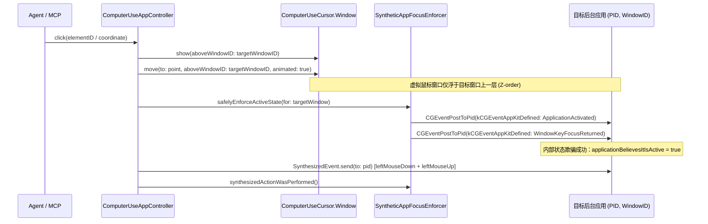

# Codex 独立虚拟鼠标与后台非侵入式操控（Virtual Cursor & Background Mode）逆向审计与架构设计方案

**日期**：2026-10-25  
**审计对象**：`/Users/ronny/.codex/computer-use/Codex Computer Use.app/Contents/MacOS/SkyComputerUseService`  
**目标工程**：`OpenComputerUse (ocu)` (`/Users/ronny/Agent/RonnyDaily/OpenComputerUse`)

---

## 一、 核心痛点对比：为什么传统 Computer Use 会干扰用户，而 Codex 不会？

| 维度 | 传统 Computer Use（以及当前 OCU 默认模式） | Codex Computer Use (`SkyComputerUseService`) |
| :--- | :--- | :--- |
| **光标呈现方式** | 直接调用 `CGWarpMouseCursorPosition` 移动系统唯一的硬件光标 (`NSCursor`) | 创建独立的透明无边框 `NSWindow`（`ComputerUseCursor.Window`），内部绘制矢量虚拟箭头，**完全不触碰系统硬件鼠标** |
| **窗口层级管理** | 全局置顶（`.screenSaver`），或者强行把目标 App 拉到最前台（`NSRunningApplication.activate()`） | 使用 `window.order(.above, relativeTo: Int(targetWindowID))`，将虚拟光标窗口**精准夹在目标 App 窗口正上方一层**，不遮挡用户当前的前台工作窗口 |
| **事件投递通道** | 全局 HID 事件流：`CGEvent.post(tap: .cghidEventTap)`，必须抢占物理鼠标位置和系统前台焦点 | 进程级定向投递：**`CGEventPostToPid(pid, event)`** + `AXUIElementPerformAction` / `AXUIElementSetAttributeValue`，直接塞入目标进程事件队列 |
| **后台失焦问题** | 后台 App 因 `NSApp.isActive == false` 拒收点击或键盘事件，因此必须抢焦点 | 通过 **`SyntheticAppFocusEnforcer`** 向目标 PID 发送伪造的 `kCGEventAppKitDefined`（`ApplicationActivated` / `WindowKeyFocusReturned`）事件，欺骗目标 App 误以为自己处于前台活跃状态 |
| **焦点防抢占防护** | 无防护，点击后台窗口会导致系统焦点切走，打断用户打字 | 内置 **`SystemFocusStealPreventer`**（挂载 `EventTap` 拦截后台进程的抢焦点通知与右键菜单关闭事件） |

---

## 二、 Codex 二进制符号级深度审计（4 大核心子系统）

通过对 `SkyComputerUseService` Mach-O 二进制的符号表（`nm -a` + `swift-demangle`）与类结构逆向分析，Codex 的非侵入式桌面操控由以下 4 个核心模块协同完成：

### 1. 独立虚拟光标渲染与物理引擎：`ComputerUse.ComputerUseCursor`

#### 1.1 逆向还原的关键符号与内存布局
- **核心类与内部子类**：
  - `ComputerUse.ComputerUseCursor`（遵循 `AccessibilitySupport.VirtualCursor` 协议）
  - `ComputerUse.ComputerUseCursor.Window`（继承自 `NSWindow`）
  - `ComputerUse.ComputerUseCursor.Style`（负责渲染 SwiftUI/NSView 矢量光标与形变状态）
  - `ComputerUse.ComputerUseCursor.AppMonitor`（负责跟踪目标 App 窗口移动与菜单打开状态）
- **成员变量（IVARs）**：
  - `ComputerUseCursor`:
    - `.window` (`ComputerUseCursor.Window`)
    - `.targetWindowID` (`UInt32?`)
    - `.correspondingApplicationPID` (`Int32?`)
    - `.shouldFadeOut` (`Bool` — 设为 `false` 时常驻桌面不消失)
    - `.activityState` (`ActivityState`)
    - `.isMoving` (`Bool`)
  - `ComputerUseCursor.Window`:
    - `.correspondingWindowID` (`UInt32`)
    - `.currentInterpolatedOrigin` (`CGPoint`)
    - `.overlayWindowLevelReasons` (`Set<...>`)
    - `.appMonitor` (`AppMonitor`)
- **窗口层级与跟随机制**：
  - `ComputerUseCursor.show(aboveWindowID: UInt32?)`：不把光标放在最高层遮挡用户，而是通过 `NSWindow.order(.above, relativeTo: Int(windowID))` 将虚拟光标窗口紧贴在目标窗口之上。
  - 当目标窗口打开了上下文菜单（`AppMonitor.menusOpen == true`）时，临时提升至 `ComputerUseCursor.overlayWindowLevel`（高于 `NSPopUpMenuWindowLevel`），菜单关闭后恢复相对层级。
  - `-[ComputerUse.ComputerUseCursor windowDidMove:]`：通过 `AppMonitor.axObserver` 监听目标窗口的 `kAXWindowMovedNotification`，当人类用户拖动目标窗口时，虚拟鼠标保持相对窗口坐标同步平移（`relativeToWindow: Bool`）。
- **弹簧与运动形变物理参数（`MotionConfiguration` & `Style`）**：
  - Codex 的虚拟鼠标在快速移动（Scoot）时具有微妙的倾角、拉伸与挤压动画（Squash & Stretch），使其极具生命感：
    - `scootTiltAngle: Angle`、`scootStretchAngle: Angle`
    - `scootStretchScale: CGFloat`、`scootStretchXScale: CGFloat`、`scootSquashYAmount: CGFloat`
    - `springResponseMin / Max`、`springDampingFraction`

---

### 2. 合成事件构造与定向 PID 投递：`AccessibilitySupport.SynthesizedEvent`

#### 2.1 为什么普通 `CGEventPostToPid` 往往点击无效？
很多开发者尝试直接用 `CGEvent(mouseEventSource: ...)` 然后调用 `event.postToPid(pid)`，却发现目标应用毫无反应。Codex 的 `SynthesizedEvent` 解决了三个魔鬼细节：
1. **必须填入目标窗口的 `CGWindowID` 与窗口内局部坐标映射**：
   - 在构造 `CGEvent` 后，必须设置隐藏字段：
     - `event.setIntegerValueField(CGEventField(rawValue: 91)!, value: Int64(windowID))`（即 `kCGMouseEventWindowUnderMousePointer` / `kCGMouseEventWindowUnderMousePointerThatCanHandleThisEvent`）
     -递增的 `mouseEventNumber`（字段 `0`）和 `mouseEventClickState`（字段 `1`）。
2. **区分进程内与跨进程 WebView/Plugin 子进程（Out-of-Process Target）**：
   - 符号 `ApplicationUIElement.outOfProcessTarget(for:appPID:)` 与 `outOfProcessTargetWindow(for:appPID:)`：针对 Safari / Chrome / Electron 等多进程架构，检出实际承载事件的 `pid` 与 `windowID`。
3. **定向投递 API**：
   - 调用 `CGEventPostToPid(pid, cgEvent)`（Swift 中为 `cgEvent.postToPid(pid)`），彻底绕过系统的全局硬件光标路由。

---

### 3. 后台焦点欺骗引擎：`AccessibilitySupport.SyntheticAppFocusEnforcer`

这是 Codex 能够在后台操作 App 而不打断前台用户工作的**最核心机密**。

#### 3.1 逆向还原的状态机与方法签名
- **状态结构 `SyntheticAppFocusEnforcer.State`**：
  - `applicationIsActive: Bool`（系统真实的活跃状态）
  - `applicationBelievesItIsActive: Bool`（目标 App **自己以为**的活跃状态）
  - `applicationBelievesItHasFocus: Bool`（目标 App **自己以为**的窗口焦点状态）
- **核心生命周期方法**：
  - `init(pid: Int32)`
  - `safelyEnforceActiveState(for: WindowUIElementProtocol?) async throws`
  - `enforceActiveState(for: WindowUIElementProtocol?) throws`
  - `startSuppressingMenuDismissalEvents(menuPID: Int32?)`
  - `stopSuppressingMenuDismissalEvents()`
  - `synthesizedActionWasPerformed()`
  - `deactivateFocusEnforcer() throws`

#### 3.2 焦点欺骗的底层实现原理（`kCGEventAppKitDefined` = 13）
macOS 的 `AppKit` 框架内部通过监听 `CGEventType(rawValue: 13)`（即 `NSEvent.EventType.appKitDefined`）来感知应用激活与窗口焦点切换：
1. **伪造 `ApplicationActivated` 事件**（`SynthesizedEvent.notifyAppActivated(windowID:windowBounds:activationPoint:)`）：
   - 创建一个 `CGEventType(rawValue: 13)` 的 `CGEvent`，设置 `subtype = 1`（`NSApplicationActivatedEventType`），附带目标 `windowID`，通过 `CGEventPostToPid(targetPID, event)` 发送给目标进程。
2. **伪造 `WindowKeyFocusReturned` / `WindowMoved` 焦点通知**（`SynthesizedEvent.notifyWindowKeyFocusReturned()`）：
   - 让目标窗口将自己标记为 `isKeyWindow = true`，从而正常响应后续通过 `CGEventPostToPid` 发来的鼠标点击、滚轮和键盘粘贴事件。
3. **等待目标应用确认状态**：
   - `ApplicationUIElement.waitUntilAppBelievesItIsFrontmost(timeout: Double)`：轮询验证目标进程已进入合成活跃态。

---

### 4. 系统焦点防抢占护盾：`AccessibilitySupport.SystemFocusStealPreventer`

当后台应用收到点击事件时，某些应用会自行调用系统 API 试图把自己拉到前台（Steal Focus），或者因为人类用户在另一处移动鼠标而导致后台应用刚弹出的下拉菜单被系统自动关闭（Menu Dismissal）。
Codex 通过 `SystemFocusStealPreventer` 解决：
- **核心符号**：
  - `SystemFocusStealPreventer.startPreventingFocusStealing(for: Int32, targetLostFocusHandler:targetGainedFocusHandler:)`
  - `SystemFocusStealPreventer.startSuppressingMenuDismissalEvents(for: Int32, menuPID: Int32?)`
  - `DisallowedThiefProcess.mouseEventTaps` / `systemProcessNotificationTap` / `viewBridgeKeyboardTap`
- **拦截机制**：
  - 利用 `CGEvent.tapCreate` 创建事件拦截器（`AccessibilitySupport.EventTap`），在 Agent 执行后台点击的瞬间（微秒级窗口期），吞掉后台进程发出的窗口前置请求与菜单失焦关闭信号。

---

## 三、 `OpenComputerUse (ocu)` 引入 Codex 虚拟指针的落地方案

为了让 `OpenComputerUse` 同时具备 **“前台真实操控模式（适合全屏演示/强兼容兜底）”** 与 **“Codex 同款后台虚拟鼠标模式（默认推荐，不抢物理鼠标、不丢虚拟箭头）”**，我们规划分三个模块合入 `OCUCore` 与 `OpenComputerUseApp`：

### 模块 1：`VirtualCursorWindow.swift`（常驻独立虚拟鼠标窗口）
- **位置**：`Sources/OpenComputerUseApp/VirtualCursorWindow.swift`
- **设计规格**：
  - 尺寸 `64×64` 的无边框透明 `NSWindow`（`ignoresMouseEvents = true`，`hasShadow = false`，`collectionBehavior = [.canJoinAllSpaces, .fullScreenAuxiliary]`）。
  - 内部渲染带呼吸发光描边的专属矢量鼠标箭头 + 右下角胶囊徽章（显示 `"OCU"` 或当前动作状态），点击时箭头产生下压缩放（`scale = 0.85`）与波纹动画，移动时根据速度向量 `(vx, vy)` 产生自然的倾角旋转（`scootTiltAngle`）。
  - **层级绑定**：提供 `attach(aboveWindowID: CGWindowID)`，调用 `self.order(.above, relativeTo: Int(aboveWindowID))`，并监听目标窗口移动事件，常驻停靠在被控窗口内部，绝不自动消失，也绝不遮挡人类用户当前的前台窗口。

### 模块 2：`SyntheticFocusEnforcer.swift`（后台进程焦点欺骗与定向投递）
- **位置**：`Sources/OCUCore/Action/SyntheticFocusEnforcer.swift`
- **设计规格**：
  - 实现 `enforceBackgroundFocus(pid: pid_t, windowID: CGWindowID, windowBounds: ScreenRect)`：
    - 构造 `CGEventType(rawValue: 13)`（`appKitDefined`）激活帧并调用 `postToPid(pid)`；
    - 构造包含 `mouseEventWindowUnderMousePointer (field 91) = windowID` 的合成鼠标与键盘 `CGEvent`，通过 `postToPid(pid)` 直接注入目标进程；
    - 对于支持 `AXValue` 的输入控件，优先使用 `AXUIElementSetAttributeValue(element, kAXValueAttribute, text)` 零延迟写入。

### 模块 3：CLI 与 MCP 双模式无缝切换 (`--virtual` / `--physical`)
- 在 `ocu click`、`ocu move`、`ocu type`、`ocu scroll`、`ocu batch` 中增加 `--virtual`（或默认开启虚拟指针模式，传入 `--physical` 退回物理鼠标接管模式）：
  - 当处于 **Virtual Cursor Mode** 时：
    1. 物理鼠标 `(NSEvent.mouseLocation)` 完全不动；
    2. 独立的 `VirtualCursorWindow` 在目标窗口上沿三阶贝塞尔曲线平滑移动并停驻；
    3. 点击与键盘输入通过 `SyntheticFocusEnforcer` + `CGEventPostToPid` 后台静默完成。
